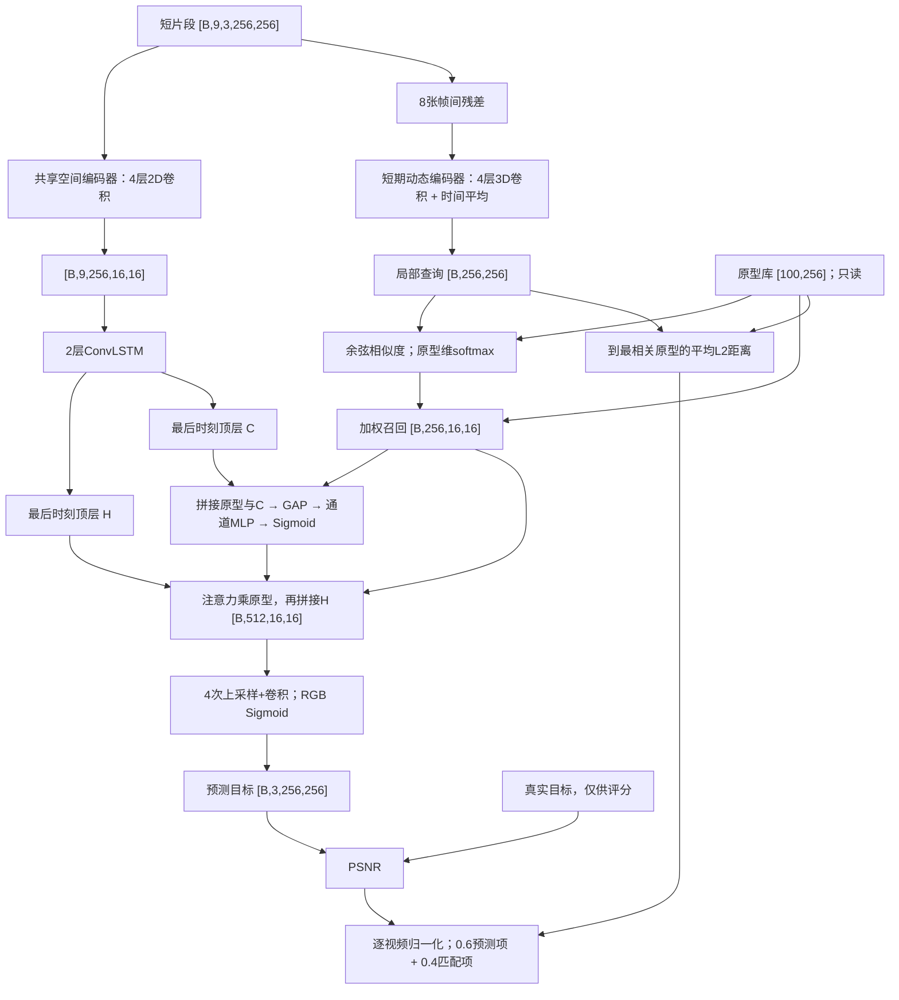
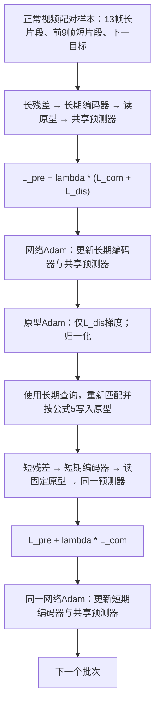

# 当前代码实现的模型结构

本文件与本目录代码对应。模型称为 PDM-Net；目录名 PDE-Net 按用户指定保留。默认结构具体化了论文未明确的卷积层配置，差异见 README。

## 推理

空间编码器通道：`3→32→64→128→256`；每层3×3、stride=2。两个动态编码器分别实例化，通道相同，使用3×3×3卷积、stride=(1,2,2)。解码器输入512通道，4次上采样各接3×3卷积，通道为 `128→64→32→32`，最后映射到3通道。

## 每个批次的交替训练

上图的原型梯度更新与显式写入顺序是本实现的工程约定。读原型时仅 detach 原型，查询保留梯度；模型 forward 不执行写入，写入由训练器第一步显式控制。

| 模块 | 第一步 | 第二步 | 推理 |
|---|---|---|---|
| 空间编码器、ConvLSTM、融合、解码器 | 更新 | 更新同一组参数 | 只读 |
| 长期动态编码器 | 更新 | 不调用 | 不调用 |
| 短期动态编码器 | 不调用 | 更新 | 只读 |
| 原型 | 仅分散梯度 + 显式写入 | 固定，仍对查询可导 | 固定 |

## 张量与采样

| 张量 | 默认形状 |
|---|---|
| 长输入 | `[B,13,3,256,256]` |
| 短输入 | `[B,9,3,256,256]` |
| 长/短残差 | `[B,12/8,3,256,256]` |
| 长/短动态特征 | `[B,256,16,16]` |
| 逐帧空间特征 | `[B,9,256,16,16]` |
| H、C | 各 `[B,256,16,16]` |
| 原型读权重 | `[B,256,100]` |
| 召回特征 | `[B,256,16,16]` |
| 通道注意力 | `[B,256,1,1]` |
| 融合特征 | `[B,512,16,16]` |
| 预测帧、目标帧 | 各 `[B,3,256,256]` |

窗口长度14，长输入取索引0..12，短输入取0..8，目标为13。测试分支不使用9..12；标签按目标13对齐，之后窗口依次平移。模型独立处理每个窗口，ConvLSTM状态不跨窗口保留。
